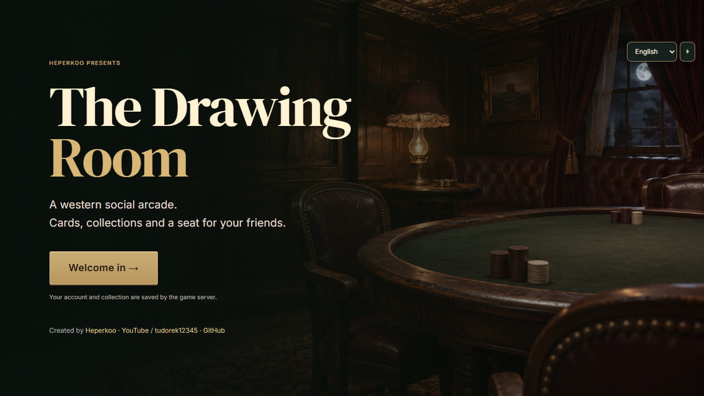
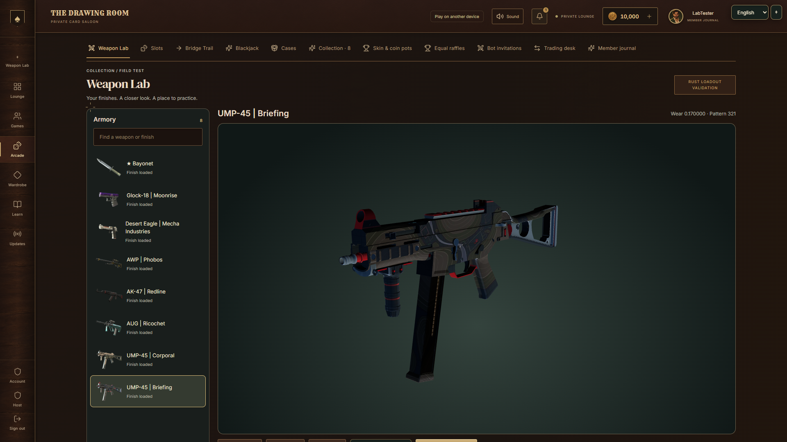
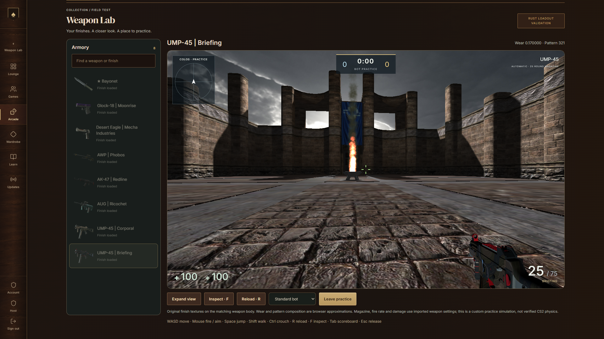

# Poker · Games · Blackjack · Rust + CS2 Weapons Lab

**The Drawing Room** is a western social arcade I am building alongside MWCMP. Play cards with friends, build a collection and spend DrawingCoins across connected games.

## What is implemented

- No-limit Texas Hold’em for 2–6 players, private room codes, practice bots, learning tools and hand history.
- Blackjack, War, Go Fish, Crazy Eights, Gin Rummy, Liar’s Dice, Skull and No Thanks!.
- Five slot machines, video-slot bonus buys, case openings, skin/coin pots, raffles and trading.
- Saved profiles, DrawingCoins, collections, levels, tasks, invitations and notifications.
- Bridge Trail: a bridge-crossing reward game with a monthly journal.
- An experimental Weapon Lab with owned-inventory inspection, locally imported weapon assets, a Rust loadout module and browser bot practice.
- English by default, with Russian, Czech, Polish and French options.

Everything uses **play currency**. There are no deposits, cash-outs or Steam inventory connections.

## Status

Active development. The game currently runs from a Windows host and is played in a browser. Friends join the same host over LAN or an authorized private VPN. Public 24/7 hosting is not deployed, and this repository is not a playable GitHub Pages build.

The weapon lab is a custom practice implementation. Exact Counter-Strike physics, recoil and paint/wear rendering have not been established. Physical mobile-device and remote-VPN testing remain outstanding. Screenshots show development builds.

## About this repository

This is the **public showcase only**: screenshots, feature notes and project information. Application source, extracted assets, packaged game builds, credentials and player saves are kept private and are not included here.

Created by **Heperkoo / tudorek12345**.

[YouTube](https://youtube.com/heperkoo) · [GitHub](https://github.com/tudorek12345)

## Weapon Lab preview

These captures use a development test profile. Imported textures are shown on the selected weapon body; wear, patterns and handling are browser approximations, not a verified Counter-Strike port.
